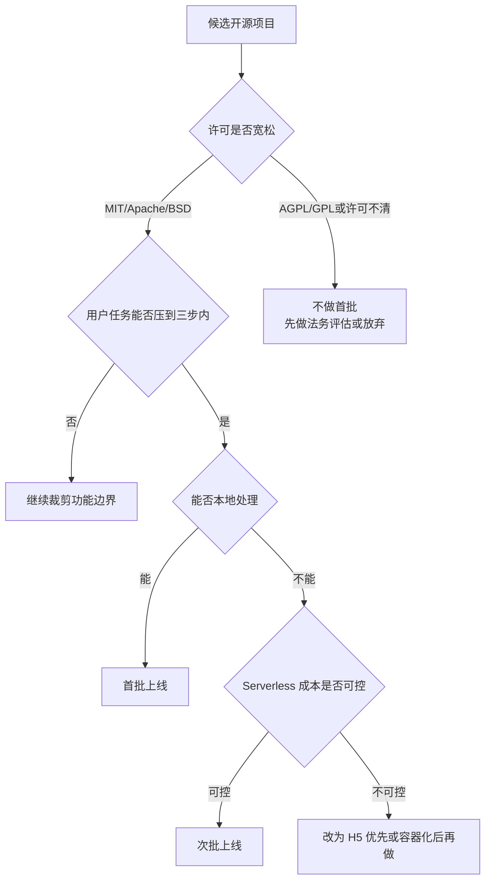
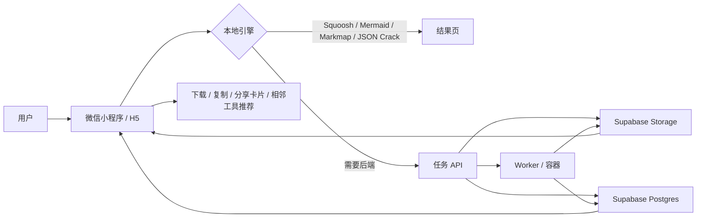

# 把 GitHub 高星开源项目的成熟功能转化为微信小程序与 H5 轻量免费工具的产品化与运营 SOP

## 执行摘要

这条路线**可行**，但最优打法不是把整个开源仓库生搬进微信小程序，而是从**宽松许可证**的高星项目里，抽取一个移动端用户能在 **3 步内完成**的核心任务，先做 **H5 优先或本地处理优先**的 MVP，再把跑通的数据型能力包进微信小程序。原因很现实：腾讯云开发者社区文章引用微信平台限制称，小程序主包大小受限（主包约 2M、分包总量约 20M），而微信小程序对 WXWebAssembly 的支持虽然已可用，但仍要求严格控制包体与性能；因此首批更适合做 **Squoosh 图片压缩、Tesseract.js OCR、SheetJS 表格清洗、Mermaid/Markmap 结构化表达、Reactive Resume 简历生成**这类前端或轻后端能力，而 **PDF 工具箱、文档扫描、背景移除**更适合作为二批以服务端微服务上线。成本上，Supabase 免费层已足够做验证，但 Vercel Hobby 明确写明面向个人项目且限**非商业、个人用途**，所以对外商业化上线建议直接上 Vercel Pro 或其他合规宿主。更重要的是，SheetJS、JSON Crack、Stirling PDF 本身就已经展示了“**免费核心能力 + 付费高级能力**”的成熟路径，这说明你完全可以先靠免费轻量工具获取微信搜索与内容流量，再逐步做批量处理、云端历史、企业版和 API 化增值。citeturn24view0turn24view1turn15view3turn19search0turn20search1turn23view1turn27view0

## 筛选原则与目标用户

把 GitHub 高星项目产品化，并不等于“开源项目 = 现成小程序”。真正适合首批验证的仓库，应该同时满足五个条件：**许可尽量宽松、单次任务高度明确、移动端三步完成、结果有明显前后对比、最好能本地处理或轻后端处理**。像 Squoosh 和 JSON Crack 这类明确声明“在浏览器本地完成处理”的项目，对微信生态尤其友好，因为它们天然降低了服务器成本与隐私压力；而像 Tesseract.js、OpenCV、Stirling-PDF、rembg 这类工具，则更适合做“**H5 优先 + 小程序壳 + 后端任务型执行**”的二层架构。citeturn15view6turn23view1turn15view7turn16view7turn16view5

从运营视角看，不建议一开始就做“大而全工具箱”，而建议先按**三条相邻产品线**切：  
其一是**图片办公线**，典型链路是“压缩 → 去背景 → 扫描件”；  
其二是**文档办公线**，典型链路是“OCR → PDF → 表格”；  
其三是**结构表达线**，典型链路是“流程图 → 思维导图 → JSON 可视化”。  
这样做的好处是：一个工具拿到搜索流量后，可以用“相邻工具推荐”来做留存，而不是强依赖用户社交分享。

| 目标用户 | 典型场景 | 核心痛点 | 最匹配的工具方向 | 更适合的获客入口 | 是否适合后续付费 |
|---|---|---|---|---|---|
| 上班族、行政、财务 | 合并合同、转扫描件、表格导出、压缩附件 | 文件处理零碎且高频，常在手机上临时完成 | PDF 工具、OCR、表格转换、图片压缩 | 微信搜一搜、微信群、朋友圈转发 | 高 |
| 学生、考证人群 | 拍讲义、提取文字、整理脑图、生成简历 | 手机拍照后需要快速结构化结果 | OCR、文档扫描、Markmap、简历生成 | 小红书图文、B 站/视频号教程、搜一搜 | 中高 |
| 电商卖家、设计助理 | 商品图压缩、去背景、改尺寸 | 图片处理重复、时间敏感 | 图片压缩、去背景、尺寸模板 | 微信群、社群教程、搜索词 | 高 |
| 产品经理、开发者、分析师 | 画流程图、JSON 可视化、整理需求脑图 | 轻量需求多，不想开重型桌面软件 | Mermaid、Markmap、JSON Crack | 技术社群、公众号、知乎、搜一搜 | 中 |
| 求职者、应届生 | 手机端快速生成 ATS 简历 | PC 简历站复杂、登录重、模板少 | Reactive Resume / JSON Resume 轻量版 | 小红书、社群、微信搜一搜 | 高 |
| 老师、培训、知识博主 | 讲义转脑图、课程流程图、资料提字 | 需要快速输出可分享图卡 | Mermaid、Markmap、OCR、图片压缩 | 视频号、小红书、公众号 | 中 |

首批上线最好优先选择**搜索意图强且解释成本低**的工具；结构化表达类工具虽然总量可能小于图片/PDF 工具，但更容易在技术社群与知识型内容里形成**高质量扩散**。

## 优先级最高的开源候选

下表把“项目成熟度 + 许可安全 + 小程序/H5 适配 + 免费价值密度”综合排序，并额外标记了**建议批次**。这里的“首批”重点是**低成本验证**，“次批”重点是**高价值但需要更重后端**。

| 建议批次 | 项目名 | GitHub 链接 | 许可类型 | 核心功能 | 为何适合小程序/H5 | 预估实现难度 | 潜在用户群 | 关键来源 |
|---|---|---|---|---|---|---|---|---|
| 首批 | Squoosh | [GoogleChromeLabs/squoosh](https://github.com/GoogleChromeLabs/squoosh) | Apache-2.0 | 图片压缩、格式转换、前后对比 | 结果可量化、搜索意图明确、天然适合“前后对比”内容；上游明确写明图片不上传服务器 | 低 | 自媒体、学生、电商卖家、运营 | citeturn15view6 |
| 首批 | Tesseract.js | [naptha/tesseract.js](https://github.com/naptha/tesseract.js) | Apache-2.0 | 图片 OCR、浏览器/Node 运行、WASM | “图片转文字”属于通用刚需；可先做单图 OCR，再扩展到截图、票据、讲义 | 中 | 学生、上班族、老师、运营 | citeturn15view7turn8search10 |
| 首批 | SheetJS CE | [SheetJS/sheetjs](https://github.com/sheetjs/sheetjs) | Apache-2.0 | 解析表格、导出新表格、CSV/XLSX 处理 | 表格清洗和格式转换天然高频；社区版和 Pro 版边界清晰，利于你模仿免费/增值分层 | 中 | 行政、财务、数据助理、学生 | citeturn16view0turn20search1 |
| 首批 | Mermaid + mermaid-live-editor | [mermaid-js/mermaid](https://github.com/mermaid-js/mermaid) [mermaid-js/mermaid-live-editor](https://github.com/mermaid-js/mermaid-live-editor) | MIT | 文本转流程图/时序图/ER 图，支持导出 SVG、分享链接 | 结果天然可分享；无文件上传隐私压力；适合内容传播与模板市场 | 低 | PM、开发者、老师、顾问 | citeturn15view5turn23view0 |
| 首批 | Markmap | [markmap/markmap](https://github.com/markmap/markmap) | MIT | Markdown 转思维导图 | 输入框 + 可视化结果的链路极短，适合移动端；学生和老师理解成本低 | 低 | 学生、老师、博主、产品经理 | citeturn16view2turn9search6 |
| 首批 | JSON Crack | [AykutSarac/jsoncrack.com](https://github.com/AykutSarac/jsoncrack.com) | Apache-2.0 | JSON/YAML/XML/CSV 可视化、导出图片、浏览器本地处理 | 面向技术人群但传播性强；本地处理、无服务端存储，适合低成本做细分工具 | 低 | 开发者、数据分析师、学生 | citeturn16view1turn23view1 |
| 首批 | Reactive Resume | [amruthpillai/reactive-resume](https://github.com/amruthpillai/reactive-resume) | MIT | 简历模板、实时预览、PDF 导出、可自托管 | 求职价值高、愿意转化；上游强调隐私优先、无追踪、MIT，可做精简移动版 | 中 | 求职者、应届生、转岗人群 | citeturn16view6turn23view2 |
| 次批 | OpenCV 文档扫描版 | [opencv/opencv](https://github.com/opencv/opencv) [TechStark/opencv-js](https://github.com/TechStark/opencv-js) | Apache-2.0 | 图像处理、边缘检测、透视矫正、浏览器/Node 可用 | “拍照转扫描件”非常适配手机入口，但包体和算力要求高于首批工具 | 中 | 学生、行政、财务、销售 | citeturn21search0turn23view3turn24view1 |
| 次批 | Stirling-PDF | [Stirling-Tools/Stirling-PDF](https://github.com/Stirling-Tools/stirling-pdf) | MIT 为主，但仓库含 proprietary/saas 等专有目录 | 50+ PDF 工具、浏览器 UI、私有 API、自托管 | PDF 需求大，但直接二开前必须做许可与功能拆分；更适合作为后端微服务能力源 | 高 | 上班族、行政、法务、财务 | citeturn16view7turn28view0turn27view0 |
| 次批 | rembg | [danielgatis/rembg](https://github.com/danielgatis/rembg) | MIT | 去背景，支持 CLI / Python / HTTP Server / Docker | 价值感极强，容易做出“秒懂”的前后对比；但后端推理成本明显高于首批产品 | 高 | 电商卖家、设计师、求职者 | citeturn16view5 |

有两个高潜项目**没有排进首批推荐**，不是因为没价值，而是因为**许可风险不适合先试水**：  
**drawDB** 和 **OpenResume** 分别采用 **AGPL-3.0**。GNU 官方 FAQ 明确指出：如果你运行的是**修改后的 AGPL 程序**并通过网络向用户提供服务，那么这些与之交互的用户应获得相应源代码。因此，除非你从一开始就打算公开修改后的源码，否则这类仓库不适合作为首批“低成本快速验证”项目。citeturn12search0turn12search3turn1search1

## 移动化可行性与裁剪策略

要把高星开源项目做成小程序/H5，核心不是“功能越多越好”，而是**把桌面式复杂软件改造成“上传/输入 → 处理 → 结果 → 导出/复制/分享”的线性任务流**。考虑到腾讯云开发者社区文章引用的微信小程序包体限制，以及腾讯云文章对 WXWebAssembly 的版本说明，首批工具应优先选择**纯前端、本地处理、轻度 WASM 或轻服务端**能力；凡是大模型、二进制编解码、长时 CPU 任务明显的功能，都应推迟到二批。citeturn24view0turn24view1

| 候选 | 首选上线形态 | 必要的功能裁剪 | 替代方案/兜底 | 隐私/合规风险 | 是否涉及付费/限量替代 | 备注与依据 |
|---|---|---|---|---|---|---|
| Squoosh | H5 优先；验证后可做小程序简化版 | 只保留 JPG/PNG/WebP 压缩、尺寸调整、质量滑杆；去掉冷门编码器、PWA、复杂比较模式 | 若小程序包体太大，就保留上传入口和结果页，把处理放 H5 | 低；上游明确说明图片本地处理，不上传服务器 | 中 | Squoosh 官方仓库明确写明本地压缩和 Apache-2.0 许可，极适合做“隐私友好免费版”citeturn15view6 |
| Tesseract.js | H5 优先；小程序做拍照/截图入口 | 首版只保留中英两种语言包、单图 OCR、复制文本；不要一上来做票据分类、表格识别、PDF OCR | 需要 PDF 时，按上游建议切到 Scribe.js 或后端 OCR 服务 | 中；图片、票据、讲义经常包含个人信息 | 强 | 上游明确说明 Tesseract.js 不支持 PDF，且是 Tesseract 的 WASM 封装citeturn15view7 |
| SheetJS | 小程序/H5 双端都可 | 先做 CSV/XLSX 预览、列筛选、行过滤、导出；不要碰复杂样式、公式求值、图表、透视表 | 复杂样式需求直接延后或做企业版 | 中；表格常带联系方式、订单数据 | 中 | SheetJS CE 做数据读写，Pro 负责更复杂模板/样式，这条免费→高级版的边界非常清楚citeturn16view0turn20search1 |
| Mermaid | 小程序/H5 双端都可 | 先只保留 flowchart、sequence、class、ER 四类模板；结果支持 PNG/SVG 导出 | 若小程序渲染不稳定，可后端调用 mermaid-cli 生成图像 | 低；通常是用户自己写的结构文本 | 中 | Mermaid 核心库负责渲染，Live Editor 已证明“编辑、导出、分享链接”模式成立citeturn15view5turn23view0 |
| Markmap | 小程序/H5 双端都可 | 先限制为 Markdown 标题和列表，不支持复杂插件语法；输出图片即可 | 大文档改 H5 处理，小程序做入口与预览 | 低 | 中 | 任务链路短，特别适合做“课件/笔记秒变脑图”的低摩擦工具citeturn16view2turn9search6 |
| JSON Crack | H5 优先，技术人群可直接用 | 首版只保留 JSON/YAML 两种输入和图像导出；暂不做 jq、JWT、代码生成 | 数据过大时切树视图或提醒去桌面端/H5 | 低；上游明确说明不存储数据，浏览器本地处理 | 中 | JSON Crack 官网写明数据只在设备端处理，并提示 300KB 左右是更现实的可视化上限citeturn23view1 |
| Reactive Resume | H5 优先；小程序做轻表单与模板选择 | 首版保留 3 套模板、实时预览、PDF 导出、本地草稿；砍掉账户、共享链接、多页面高级配置 | 若你想更轻，可改用 JSON Resume schema 做更薄的生成器 | 中高；简历包含姓名、电话、学校、经历 | 强 | 上游文档强调隐私优先、PDF 导出、MIT 授权；非常适合做“免费基础版 + 模板增值”citeturn23view2turn16view6 |
| OpenCV 扫描件版 | H5 优先；小程序做拍照入口与手动裁剪 | 只做边缘检测、透视矫正、灰度/黑白滤镜、导出图片/PDF；不要扩成通用 CV 平台 | 当自动边缘识别失败时，提供“手动四点裁剪”兜底 | 中高；扫描内容可能是证件、合同、票据 | 强 | OpenCV 是通用 CV 库，浏览器可通过 opencv-js 使用；微信侧对 WASM 可用，但包体/性能要极谨慎citeturn21search0turn23view3turn24view1 |
| Stirling-PDF | 后端微服务优先，小程序/H5 只做前端壳 | 只保留 4 个高频操作：合并、拆分、压缩、图片转 PDF；暂不做签名、审计、SSO、复杂流程编排 | 不直接二开其整套前端；把它当后端能力源或能力清单参考 | 高；PDF 通常包含合同、身份证明、发票、简历 | 强 | 官方案例显示其核心工具密集且可 API 化，但其仓库 LICENSE 明确列出了 proprietary/saas 等专有目录，不能“整库即商用”citeturn16view7turn28view0turn27view0 |
| rembg | 后端微服务优先；H5/小程序只做上传和结果 | 只做单张图片、透明 PNG 输出、文件上限 10MB；不要一上来做批量或视频去背景 | 用异步任务队列和结果轮询，避免前端长等待 | 高；证件照、人像、商品图都可能构成敏感隐私数据 | 强 | 上游明确支持 HTTP server / Docker，非常适合作为“单能力”微服务，但推理成本明显高于首批候选citeturn16view5 |

这张表背后的结论非常明确：  
**首批免费、小流量验证**，优先做 **Squoosh / Mermaid / Markmap / JSON Crack / SheetJS / Tesseract.js / Reactive Resume**；  
**第二阶段高价值扩张**，再上 **OpenCV 扫描件 / Stirling PDF / rembg**。  
不要反过来做。

## MVP 模板与低成本技术实现

就技术路径而言，最稳妥的方案是：**H5 先跑通功能和 SEO/内容入口；微信小程序做轻壳、低摩擦入口、分享承接和次级留存；真正重的处理逻辑尽量留在本地浏览器或后端微服务**。这样做不仅更符合多数开源仓库原本的 Web/JS 技术路径，也更能绕开小程序包体约束和 WASM 适配成本。腾讯云开发者社区文章引用的微信包体限制、Supabase 的免费额度、Vercel 的非商业 Hobby 条款以及 Vercel Functions 对 CPU 型任务的计费方式，都支持“**本地优先，后端只做不可避免的任务**”这条原则。citeturn24view0turn19search0turn19search11turn19search19turn15view3turn15view4

| MVP 模块 | 页面内容 | 关键交互 | 必备埋点 | 设计重点 |
|---|---|---|---|---|
| 首页 | 工具标题、一个核心卖点、3 个典型场景、主 CTA | 上传/输入、选择模板、进入工具 | 首页曝光、CTA 点击率 | 名称直接说人话，不先讲技术名词 |
| 工作区 | 上传区/输入区、预设选项、示例模板 | 上传文件、粘贴文本、拍照、改参数 | 输入完成率、文件大小、参数选择分布 | 所有首屏元素只围绕“完成任务” |
| 处理中 | 进度、取消、隐私提示 | 等待、取消、重试 | 任务耗时、失败率、退出率 | 重任务必须让用户知道还在处理 |
| 结果页 | 前后对比、复制/下载/导出、再次处理、相邻工具推荐 | 下载图片、复制文本、导出 PDF、分享卡片 | 导出率、复制率、二次处理率、相邻工具点击率 | 结果页才是留存页，不要只做一个“完成”提示 |
| 最近使用 | 本地历史、最近参数、最近模板 | 一键复用上次配置 | 复用率、7 日回访率 | 首版优先本地历史，不急着强制登录 |
| 帮助与合规页 | 隐私说明、开源披露、问题反馈、FAQ | 查看披露、提交反馈 | 帮助点击、反馈提交率 | 这是过审和合规的基本盘 |

**通用交互原则**很简单：  
首页不要放太多功能；工作区只保留 **1 个主任务 + 2 个参数**；结果页一定要有 **“再次处理”** 和 **“下一个相邻工具”**；最近使用默认存在本地，不急着一开始就上云同步。

分享卡片不用做得花哨，但要做出**结果感**。推荐三种固定样式：

| 卡片类型 | 适合工具 | 文案模板 | 视觉元素 |
|---|---|---|---|
| 数值对比卡 | 压图、PDF、扫描件 | `3.8MB → 280KB，节省 92%` | 前后数字大字、下载按钮截图 |
| 成果展示卡 | Mermaid、Markmap、JSON Crack | `我用 30 秒把需求文档变成了图` | 结果图预览 + 工具名 |
| 任务完成卡 | OCR、简历生成 | `已提取 2,341 字` / `已生成 ATS 简历 PDF` | 结果摘要 + 复制/下载提示 |

运行时的数据流，建议从第一天就按“**本地能算就本地算，不能本地算才入任务队列**”设计。

在基础设施上，建议把“**静态前端、轻状态后端、重处理容器**”分离，不要让一个平台同时承担所有工作。

| 层级 | 推荐方案 | 作用 | 低成本建议 |
|---|---|---|---|
| 小程序前端 | React 多端框架（例如 Taro，未指定版本）或原生小程序 | 承接微信入口、拍照/上传、结果页、分享 | 只做壳层与轻交互，不做重引擎 |
| H5 前端 | React/Next.js（未指定版本） | 复用大部分 Web 开源仓库、做 SEO/内容页 | 若用 Vercel，开发预览可用 Hobby；**对外商业化上线不建议继续停留在 Hobby**，因为其官方说明为非商业个人用途citeturn15view3turn22search2 |
| 数据与状态 | Supabase Postgres + Storage + RLS + Edge Functions | 存任务状态、用户反馈、模板、结果文件 | Supabase 官方免费层含 50,000 MAU、500MB DB、1GB 文件存储、5GB egress、500,000 Edge Functions 调用，且默认只适合轻量验证；免费项目文件大小上限不能超过 50MBciteturn19search0turn15view1turn15view2turn19search19turn19search7 |
| 重任务执行 | 单独容器化 worker | OCR、PDF、去背景、扫描件等重处理 | 不建议把 CPU 型图像/PDF处理长期放在 Vercel Functions，因为官方文档明确说明 image processing 这类任务更耗 Active CPUciteturn15view4 |

月成本最好按**三档**估算，而不是幻想“一套免费层覆盖全部生产”。

| 档位 | 适合工具 | 月成本估算 | 说明 |
|---|---|---|---|
| 本地处理档 | Squoosh、Mermaid、Markmap、JSON Crack | 开发验证期可接近 $0；公开商业化基线建议按 **Vercel Pro $20/月** 或其他宿主计算 | 计算基本在客户端完成，后端只做埋点/反馈；Vercel Pro 官方平台费为 $20/月citeturn22search2 |
| 轻后台档 | Tesseract.js、SheetJS、Reactive Resume | 约 **$25–$45/月** | 通常为 Supabase Pro $25/月 + 轻量前端宿主；Supabase Pro 官方基价 $25/月citeturn22search1 |
| 重处理档 | OpenCV 扫描件、Stirling-PDF、rembg | **$35–$100+/月**，具体取决于供应商与使用量，未指定 | 这里的关键不是前端宿主，而是重处理 worker；供应商与地域未指定 |

以下成本本文不做展开，统一标注为**未指定**：  
**域名、备案、微信主体认证、支付通道、短信、CDN 地域加速、客服系统**。

把开发和运营交给 LLM/agent 时，建议按下面这张工作表来分工，让“人只做选择和最后审核”。

| 环节 | 人工最少动作 | LLM / Agent 负责内容 | 主工具 |
|---|---|---|---|
| 仓库审计 | 提供 repo 链接，确认是否要做 | 输出功能地图、构建方式、许可摘要、移动端阻碍点 | Claude / Codex |
| MVP PRD | 选一个主场景 | 生成页面结构、交互流、异常流、埋点方案 | GPT Plus / Claude |
| 代码适配 | 审核关键 diff | 生成 H5 页面、小程序壳、API 封装、类型定义 | Cursor / Codex |
| QA | 跑测试、看录屏 | 自动生成边界用例、回归测试、错误复现脚本 | Codex / Cursor |
| 合规文档 | 审核字眼是否准确 | 生成隐私文案、开源披露页、FAQ | Claude / GPT Plus |
| 内容生产 | 选关键词与案例 | 批量生成 20 条标题、脚本、封面文案、卡片文案 | GPT Plus / Claude |

## 推广、种草与留存 SOP

这类免费工具的增长，不应该一概而论。  
**带私密数据的工具**（OCR、PDF、简历、扫描件）更适合靠**搜索流量、场景教程、模板案例**增长；  
**结果天生可展示的工具**（Mermaid、Markmap、JSON Crack）更适合靠**示例图、模板包、社群扩散**增长。  
也就是说，你不能指望用户把自己的简历、合同、票据大规模分享出去，但你可以指望他们搜索“图片压缩”“图片转文字”“流程图生成”时找到你。腾讯云开发者社区文章提到，小程序支持自定义关键词，最多可提交 10 个关键词且需一次性提交审核；同时部分运营资料提到后台“搜索分析”与“微信指数”可作为后续优化参考，但覆盖范围有限，不能等同于完整 SEO 数据。citeturn26view0turn24view5

最适合首批验证的内容模板，不是“我做了个工具”，而是“**1 个具体场景 + 1 个明确结果 + 1 个立即 CTA**”。

| 渠道 | 内容模板 | 示例脚本/结构 | 自动化程度 | CTA |
|---|---|---|---|---|
| 短视频 15–25 秒 | 痛点开头 + 处理过程 + 前后结果 | `3.8MB 的报名照发微信就糊？我用这个免费工具压到 280KB，肉眼几乎看不出区别。` | 高；可以用固定 demo 文件反复产出 | `微信搜：图片压缩助手` |
| 小红书 6 图笔记 | 首图痛点、2 图步骤、2 图结果、1 图 FAQ | `免费、无需登录、结果本地处理/秒出结果` | 高；Agent 可批量生成封面文案 | `文末放小程序名 + 关键词` |
| 社群长图/公众号 | 案例合集 | `今天整理了 5 个开源能力改造出来的免费小工具` | 中高 | `收藏 + 转给常用的人` |
| 技术社群/知乎 | 模板案例与源码思路 | `用 Mermaid/JSON Crack/Markmap 做移动端表达工具` | 中 | `示例图 + H5 链接 + 小程序入口` |

首批 14 天的推广建议，不是拼命铺量，而是做**固定格式的 10–20 条种子内容**。  
推荐一个很省人工的节奏：

| 时间 | 目标 | 动作 |
|---|---|---|
| 第 1–2 天 | 做 3 组固定 demo 文件 | 每个工具准备一份“典型输入”样例，后续所有视频/图文都复用 |
| 第 3–5 天 | 发布首批内容 | 每个工具至少 3 条内容：痛点版、教程版、结果展示版 |
| 第 6–7 天 | 看数据不看感觉 | 只看 4 个数：CTR、完成率、导出率、二次访问 |
| 第 8–10 天 | 做标题与封面复写 | 把点击高的内容换 3 个标题版本，再发 |
| 第 11–14 天 | 做相邻工具联动 | 在结果页与内容中推荐“下一个工具”而不是继续讲同一工具 |

小程序搜索优化不建议“玄学化”，建议做一个固定清单：

| 项 | 建议做法 | 说明 |
|---|---|---|
| 名称 | `功能词 + 场景词` 优先，例如“图片压缩助手”“图片转文字 OCR” | 首发阶段品牌名排在功能名后面 |
| 关键词 | 一次性把 10 个关键词填满；避免只填 1–2 个就提交审核 | 腾讯云转载文章指出最多 10 个关键词、7 个工作日审核、30 天仅能修改 3 次citeturn26view0 |
| 简介 | 自然写同义词，不堆砌 | 让“压图/压缩图片/缩小附件”“OCR/图片转文字/提取文字”同时出现 |
| 关键词迭代 | 结合后台已有关键词访问次数与“微信指数”做微调 | 第三方文章指出“搜索分析”与“微信指数”可作为参考，但覆盖有限，要把它当方向盘，不是仪表盘citeturn24view5 |
| 内容命名 | 每条内容只讲 1 个具体需求 | “免费图片压缩”优于“我的工具箱上线了” |

留存这件事，对免费工具比获客更重要。因为绝大多数工具类产品的单次任务都很短，不设计留存点，用户用完就走。最有效的留存触发器不是“关注公众号”，而是**结果页上的下一步**。

| 留存触发器 | 实现方式 | 最适合的工具 |
|---|---|---|
| 最近使用 | 本地保存最近 5 次任务与最近参数 | 全部 |
| 一键复用上次设置 | 结果页直接出现“用同样设置再处理” | 图片压缩、PDF、OCR |
| 模板库 | 给用户可直接套用的模板输入 | Mermaid、Markmap、Reactive Resume |
| 相邻工具推荐 | 结果页底部推荐 1 个上下游工具 | OCR → PDF；压图 → 去背景；脑图 → 流程图 |
| 结果卡可再次编辑 | 不是只给下载，还给“继续改” | Mermaid、Markmap、JSON Crack |
| 每周模板更新 | 每周上新 3 个模板并置顶 | 简历、流程图、思维导图 |

一个比较务实的验证标准是：  
**不是看总访问量，而是看“完成任务的人有多少、导出的人有多少、再次回来的人有多少”。**  
如果一个工具的完成率、导出率都不高，那说明不是推广问题，而是**产品链路问题**。

## 变现优先级与法律合规

免费工具要先赢得**第一次使用**，再谈变现。变现顺序应该围绕“**不打断任务完成**”来设计：  
先给足免费核心能力，再把**批量、云历史、模板、高清导出、团队/企业功能**作为增值项；广告则应放在更后面，因为多数工具会处理私密文件，硬塞广告既伤转化，也容易伤口碑。

| 变现优先级 | 模式 | 最适合的工具 | 建议做法 |
|---|---|---|---|
| 最高 | 免费核心能力 | 全部 | 单文件、单图、单模板完全免费，先拿搜索流量和口碑 |
| 高 | 付费增值 | PDF、OCR、图片压缩、去背景、简历 | 批量处理、更多模板、云端历史、高清导出、无水印 |
| 中高 | 企业版 / 私有部署 / API | PDF、OCR、文档扫描、简历 | 面向学校、公司、机构卖“私有部署 + API + SLA” |
| 中 | 模板市场 | Mermaid、Markmap、Reactive Resume | 卖行业模板、简历模板、流程图库 |
| 低 | 广告 | 图片压缩、轻图像工具 | 只有在 DAU 做起来且不伤体验时再上 |
| 最低 | 流量变现 | 全部 | 不要太早做跳转分发，否则工具心智会被破坏 |

你可以把上游项目已经存在的商业化路径，直接拿来当作“免费版边界设计”的参考：  
SheetJS 公开区分了 Community Edition 与 Pro；JSON Crack 官网明确提到高级功能已迁到 ToDiagram.com；Stirling PDF 官方文档也给出了 Free / Server / Enterprise 的分层。这说明“开源核心 + 工具型包装 + 高级功能付费”本身就是成立的商业模型。citeturn20search1turn23view1turn27view0

真正容易踩坑的，不是“如何收费”，而是**法律与合规**。这部分必须前置。

| 风险点 | 你该怎么做 | 依据 |
|---|---|---|
| MIT / Apache 复用 | 保留 LICENSE、版权声明和必要归属；在 H5/小程序“关于/开源披露”页集中展示 | GitHub 的 Choose a License 对 MIT 和 Apache 2.0 都给出了典型条件说明；SheetJS 文档还明确要求集成 CE 时补充归属文本citeturn17search0turn17search1turn20search1 |
| AGPL / GPL 仓库 | 若你不准备公开修改后的源码，就不要把 AGPL 仓库放进首批项目；能不用就先不用 | GNU FAQ 明确说明：修改后的 AGPL 程序通过网络向用户提供服务时，应向这些用户提供修改后的源码；drawDB 与 OpenResume 均为 AGPL-3.0citeturn1search1turn12search0turn12search3 |
| 混合许可/开核商业仓库 | 不要“整仓商用”；先审 LICENSE，看是否有 proprietary/saas 子目录 | Stirling-PDF 的 LICENSE 明确列出 proprietary、saas、engine、portal 等目录可能适用其他许可证，且其官方文档存在付费 plan 分层citeturn28view0turn27view0 |
| 只看 package.json/README 的许可证标签 | 把“读取 LICENSE/NOTICE 原文”做成自动化步骤 | GitHub 许可资料与 2026 年一项关于开源 AI 供应链许可完整性的研究都提醒：真正可依赖的是 LICENSE/NOTICE 与上游披露，不是单一元数据标签citeturn17search2turn20academia23 |
| 微信小程序隐私声明 | 只要调用隐私相关接口/组件，就必须配置《小程序用户隐私保护指引》；未声明则接口/组件可能被禁用或提审失败 | 微信隐私授权接入教程与腾讯云适配说明都指出，涉及个人信息处理必须声明，且未声明会影响接口/组件可用性与审核citeturn24view2turn24view3 |
| 上传文件的敏感性 | 默认不公开、不做公开画廊；结果文件设置短期删除；能本地处理就本地处理 | Squoosh、JSON Crack、Reactive Resume 等项目都把“本地处理/隐私优先”作为核心卖点，说明这是工具产品的重要用户心智citeturn15view6turn23view1turn23view2 |
| 公司 IP 与职务成果 | 不复用公司代码、PRD、设计图、内部数据、私有 Prompt、未公开业务逻辑；最好使用独立仓库、独立账号、独立设备与非工作时间开发 | 是否构成公司 IP 归属取决于劳动合同、员工手册、开发环境与证据链，本文不提供法律意见；如你打算开源自己的衍生项目，GNU 自身的许可证 how-to 也建议先取得雇主版权免责声明citeturn1search2 |

一句话总结这部分：  
**先选宽松许可，先做本地处理，先把披露页和隐私页写好，再谈增长。**

## 可立即执行的优先任务

| 优先任务 | 预计时间 | 首要工具 | 交付物 |
|---|---|---|---|
| 确定首批 2 个工具并完成仓库/许可审计 | 2–3 小时 | Claude / Codex + GitHub | 一页 A4 的 `功能裁剪清单 + 许可风险清单 + 首批/次批决策` |
| 用 Squoosh 或 Tesseract.js 做第一个 H5 MVP | 1–2 天 | Cursor + Codex + Vercel / Supabase | 一个可公开测试的 H5 链接，具备首页、工作区、结果页、帮助页 |
| 为 MVP 生成首批 10 条种子内容并上线微信承接页 | 0.5–1 天 | GPT Plus / Claude + 微信开发者工具 | 10 条固定模板内容、1 个小程序壳或入口页、1 套关键词与标题库 |

如果你要**最快见到结果**，建议从这两个里二选一作为真正的第一枪：  
**Squoosh 图片压缩**，因为它本地处理、隐私友好、前后对比最直观；  
或者 **Mermaid/Markmap**，因为它内容可展示、传播性更强、后端几乎为零。  
而 **PDF、去背景、扫描件**，请放到你拿到第一波真实使用数据之后再做。