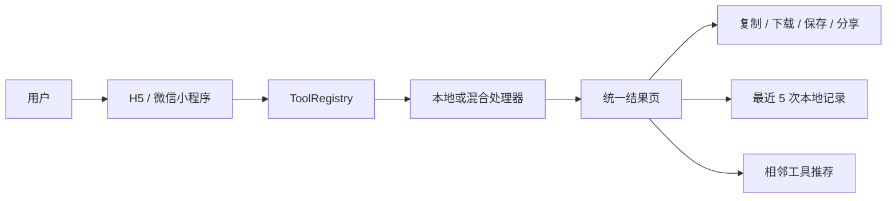

# 0→1 技术架构说明

## 决策

采用 `H5 应用 + 微信小程序轻壳 + shared core` 三层架构。

- H5：承载完整工具体验、公开测试链接、内容承接页、开源披露和隐私说明。
- 小程序：承接微信搜索、拍照/上传、结果页、分享卡片和最近使用。
- shared core：统一工具注册、处理器接口、结果类型、埋点事件、最近记录和合规元数据。

## 模块边界

| 模块 | 责任 | 首版实现 |
|---|---|---|
| H5 | 多工具任务中心、处理流程、统一结果页 | React + Vite + Canvas + Tesseract.js + pdf-lib |
| shared core | ToolRegistry、manifest、processor、结果类型、埋点 | TypeScript |
| 小程序壳 | 微信入口、拍照/选文件、轻处理、结果承接、分享 | 原生小程序多页结构 |
| 后端 | 可选埋点、反馈、云 OCR/worker 接口 | 首版不强依赖 |
| worker | OCR/PDF/去背景等重任务隔离 | 二阶段按数据引入 |

## 数据流

## 工具分层

- P0：`photo-ocr`、`scan-to-pdf`、`pdf-tools`、`image-tools`。
- P1：`qr-tools`、更完整的图片裁剪/尺寸/格式转换。
- P2：证件照、商品图去背景、Mermaid/Markmap/Excalidraw 学习表达工具线。

## 小程序策略

小程序不把 Tesseract.js/WASM 和复杂 PDF 逻辑强塞进首包。首版先完成多页入口、微信选文件、最近记录、结果页和分享路径；重处理优先复用 H5/shared core，或在后续接云 OCR 与独立 worker。
