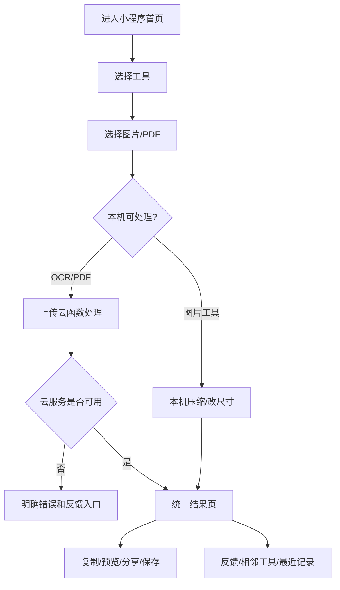

# 手机办公文件处理助手 PRD V1.0

## 1. 产品目标

在微信小程序内完成常见轻办公文件任务：拍图识字、扫描成 PDF、PDF 合并/图片转 PDF、图片压缩与改尺寸。不下载 App，不注册账号，尽量三步完成。

首版目标不是功能数量最多，而是确保小程序端主链路真实可用、失败可解释、结果可导出、反馈可回收。

## 2. 用户与场景

| 用户 | 场景 | 成功标准 |
|---|---|---|
| 学生/老师 | 讲义、白板、作业截图识字；多图整理成 PDF | 能复制文字或分享 PDF |
| 行政/财务 | 报名材料、票据、合同照片整理 | 能生成 PDF、合并文件、留存记录 |
| 运营/电商 | 商品图压缩、活动图调整、材料转 PDF | 能在微信内处理并发送 |
| 普通上班族 | 临时收到图片/PDF，需要快速处理 | 不安装 App 也能完成任务 |

## 3. 首版范围

In Scope：

- 小程序首页四入口：拍图识字、扫描成 PDF、PDF 工具、图片工具。
- 小程序端真实主流程：OCR/PDF 通过云函数完成，图片工具本机完成。
- 统一结果页：文本复制、PDF 预览/分享、图片保存、反馈、相邻工具推荐。
- 云函数：`ocrRecognize`、`pdfProcess`、`feedbackSubmit`。
- 合规提示：文件短期云处理、OCR 敏感信息、最近记录仅保存元数据。

Out of Scope：

- PDF 拆分/提取页、扫描增强、表格结构化识别。
- 登录、会员、云历史、公开文件库。
- 去背景、证件照、二维码、Mermaid/Markmap/Excalidraw。
- 未配置云 OCR 时展示模拟识别结果。

## 4. 用户故事

- 作为学生，我可以拍一张讲义截图，得到可复制文字，并在识别不准时提交反馈。
- 作为行政，我可以选择多张材料照片，按顺序生成 PDF 并预览分享。
- 作为上班族，我可以从聊天选择多个 PDF 合并成一份。
- 作为运营，我可以压缩大图、限制最长边，并保存到相册。

## 5. 主流程

## 6. 指标

North Star Metric：每周小程序端完成并导出的办公文件处理任务数。

必须埋点：`home_view`、`cta_click`、`input_ready`、`process_start`、`process_success`、`process_fail`、`export_click`、`related_tool_click`、`feedback_submit`。

每个事件必须带：`toolSlug`、`channel=mini-program`、`inputType`、`outputType`、失败时 `reason/errorCode`。

## 7. 验收标准

- 小程序 OCR/PDF/扫描页主按钮不再是“在 H5 打开”。
- OCR 未配置凭证时显示 `OCR 服务未配置`，不得展示假文本。
- 扫描成 PDF 与 PDF 工具返回真实 `fileID` 后才能进入 PDF 结果页。
- 图片工具可本机处理、显示节省比例、保存相册并引导权限。
- 结果页支持文本、PDF、图片三类结果和反馈提交。
- `npm run verify` 与 `npm audit --audit-level=critical` 通过。
